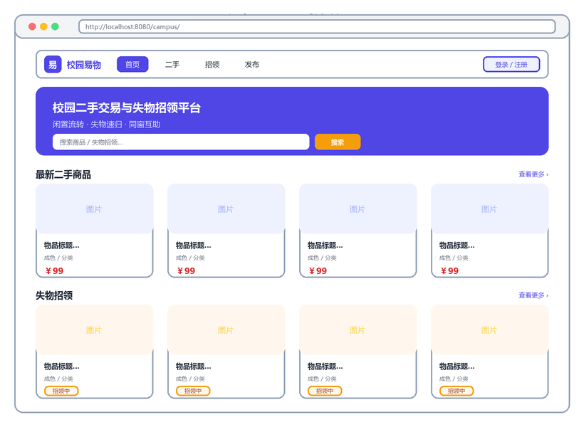
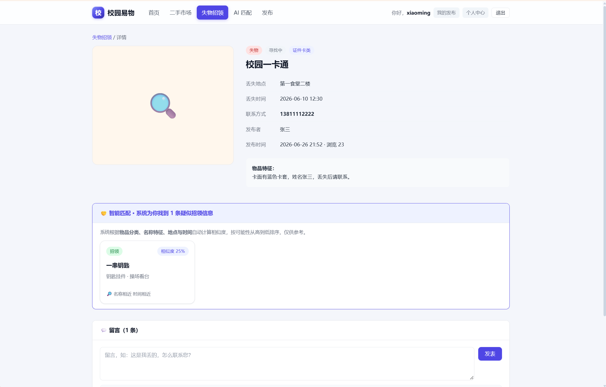
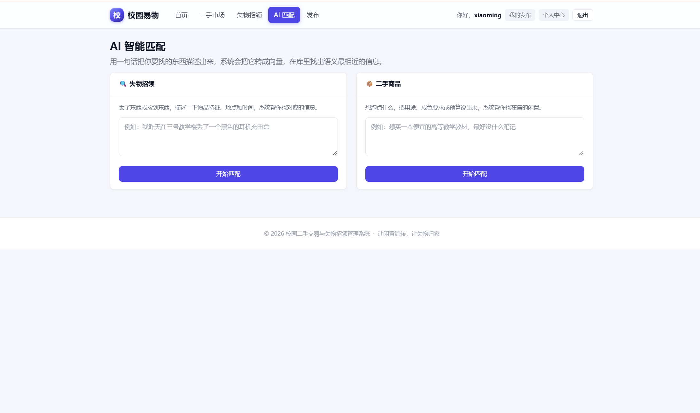
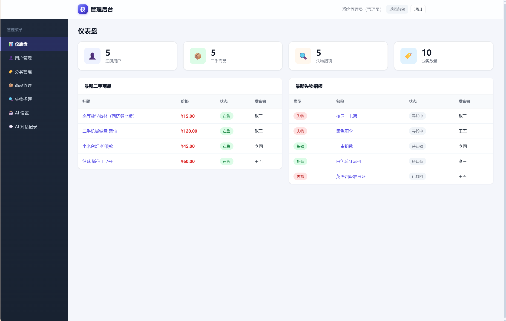
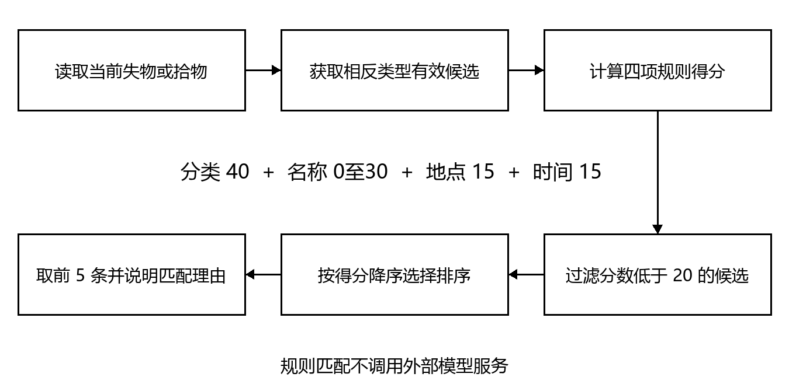
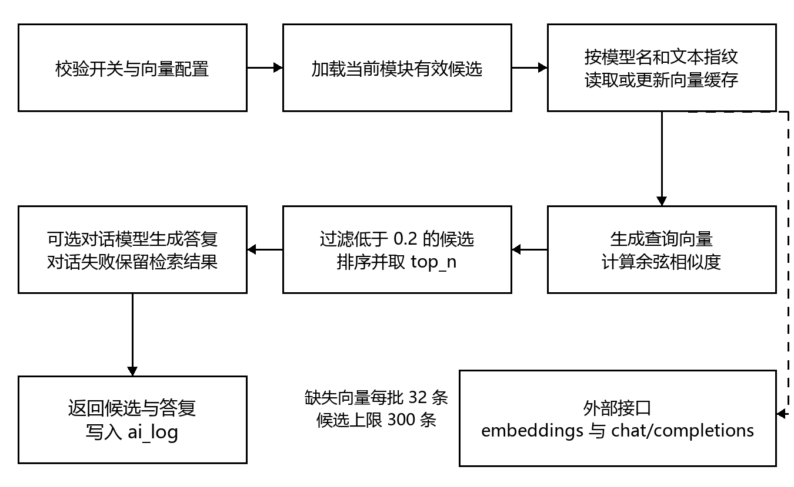
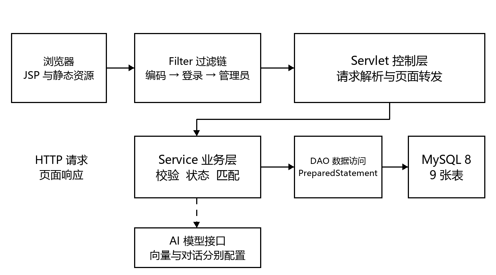
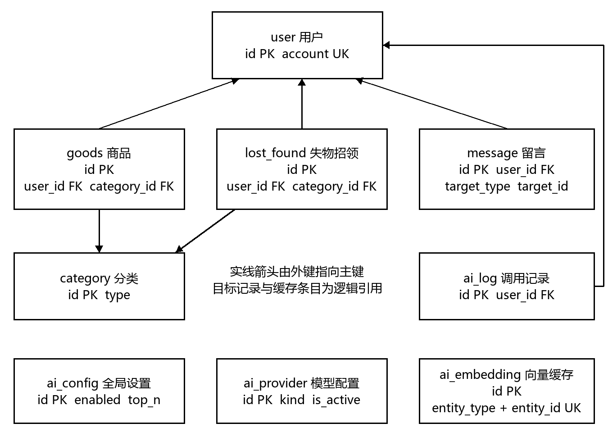

# 校园二手交易与失物招领管理系统

**Campus Secondhand Trading & Lost-and-Found Management System**


基于 **Servlet + JSP + JDBC + MySQL** 的 Java Web 课程实训项目，为校园用户提供二手商品发布、失物招领、留言和后台管理。系统实现了失物与拾物之间的规则匹配，以及按自然语言描述检索商品或失物招领信息的 AI 语义检索。交易通过发布者联系方式协商，系统不包含在线支付。



[功能一览](#功能一览) · [规则匹配](#规则匹配) · [AI 语义检索](#ai-语义检索) · [技术与结构](#技术与结构) · [部署运行](#部署运行) · [数据库](#数据库) · [常见问题](#常见问题)

## 功能一览

| 模块 | 功能 |
| --- | --- |
| 用户 | 注册、登录、退出、个人资料、修改密码 |
| 二手商品 | 发布、图片上传、分类与关键词筛选、详情、个人发布管理、状态维护 |
| 失物招领 | 发布失物或拾物、分类筛选、详情、个人发布管理、状态维护、反向信息推荐 |
| 留言 | 在商品或失物招领详情下留言；本人或管理员可删除留言 |
| AI | 按描述检索、向量缓存、可选的对话模型解释、个人查询记录 |
| 后台管理 | 用户、分类、商品、失物招领管理，以及 AI 配置、日志和索引重建 |

系统采用登录墙：登录、注册、`/favicon.ico` 和 `/static/` 静态资源可匿名访问，其他页面需要登录；后台还会检查管理员角色。

<details>
<summary>查看运行界面</summary>

**失物招领详情与规则匹配**



**AI 语义检索入口**



**管理员后台**



</details>

## 规则匹配

打开失物或拾物详情时，系统从“相反类型且仍在进行中”的信息中寻找候选。例如，失物对应未认领的拾物，拾物对应尚未找回的失物。算法在本地运行，不需要外部 AI 服务。

| 维度 | 当前实现 | 分值 |
| --- | --- | --- |
| 分类 | 非空的 `categoryId` 相同 | +40 |
| 名称与特征 | 源信息名称的每个相邻双字符片段，命中候选的“名称 + 特征” | 每次 +10，最多 +30 |
| 地点 | 两个地点均非空，且一个字符串包含另一个 | +15 |
| 时间 | 毫秒差换算为整数天，结果不超过 7 | +15 |

保留得分 **≥20** 的候选，以选择排序按得分降序排列，详情页最多显示 **5 条**，同时列出匹配理由。满分为 100，页面中的百分比是规则得分，不是统计概率。



名称匹配具有方向性：算法从源名称拆出双字符片段，到候选名称与特征中查找，交换两条信息后得分可能不同。地点只做字符串包含判断，无法自动理解“三教”和“三号教学楼”等别名；时间计算采用整数除法，7 天多但不足 8 天的差值仍可能获得时间分。

实现见 [MatchUtil.java](src/main/java/com/campus/util/MatchUtil.java) 和 [LostFoundServiceImpl.java](src/main/java/com/campus/service/impl/LostFoundServiceImpl.java)。

## AI 语义检索

用户选择“失物招领”或“二手商品”模块，再输入自然语言描述。系统仅检索所选模块中状态有效的条目：进行中的失物、未认领的拾物，或在售商品。

检索过程为：读取候选 → 复用或生成条目向量 → 生成查询向量 → 计算余弦相似度 → 返回相关条目。配置了可用的对话模型后，还可以根据检索结果生成解释；对话生成失败时仍保留向量检索结果。



| 参数 | 当前实现 |
| --- | --- |
| 查询长度 | 最多 500 字符 |
| 候选数量 | 每次最多 300 条 |
| 向量生成批次 | 每批最多 32 条 |
| 相似度阈值 | 余弦相似度 ≥0.2 |
| 返回数量 | `top_n` 默认 5，可配置为 1～20 |
| 缓存更新依据 | 模型名称、条目文本的哈希值 |
| 请求超时 | 连接 10 秒，读取 90 秒 |
| 查询记录 | 保存到 `ai_log`，包含结果、耗时和状态 |

### 配置方法

1. 使用管理员账号进入后台的 AI 设置页面。
2. 配置向量服务的地址、模型名称和服务要求的 API Key，并激活该向量服务。
3. 执行后台连通性测试，确认接口返回有效向量。
4. 按需配置并测试对话服务，设置返回数量，再开启 AI 总开关。
5. 回到前台检索；出现异常时查看后台 AI 日志。需要更新缓存时使用索引重建功能。

客户端调用兼容的 `/embeddings` 和 `/chat/completions` 接口，服务地址与模型名称必须符合所接入服务的要求。初始化脚本预置 `BAAI/bge-m3` 和 `deepseek-chat` 两条配置示例，Key 为空，**AI 默认关闭**。示例配置不能代替实际连通性测试。

页面显示“就绪”仅表示总开关及必要配置满足检查条件，不保证远程服务可用。编辑服务商时，留空 Key 会保留原值；若切换服务地址但沿用同一模型名称，应重建索引，避免复用旧服务的向量。

实现见 [AiServiceImpl.java](src/main/java/com/campus/service/impl/AiServiceImpl.java)、[AiClient.java](src/main/java/com/campus/util/AiClient.java) 和 [VectorUtil.java](src/main/java/com/campus/util/VectorUtil.java)。

## 技术与结构

| 项目 | 配置或版本 |
| --- | --- |
| Java | 源码与编译目标均为 Java 8 |
| Servlet API | `javax.servlet-api` 4.0.1，由容器提供 |
| JSP API | `javax.servlet.jsp-api` 2.3.3，由容器提供 |
| JSTL | 1.2 |
| 数据库驱动 | MySQL Connector/J 8.0.33 |
| JSON | Gson 2.10.1 |
| 构建与部署 | Maven，WAR 包，Tomcat 9 |
| 数据库 | MySQL 8，InnoDB，utf8mb4 |

请求经 Filter 完成编码、登录与角色检查，再进入 Servlet、Service 和 DAO。DAO 使用 JDBC 与 `PreparedStatement` 操作数据库，JSP 渲染页面。项目没有使用 Spring 或 MyBatis。



```text
campus-system/
├── pom.xml
├── sql/
│   ├── schema.sql                 # 全量初始化，会重建数据库
│   └── migrate_ai_tables.sql      # 为已有业务库补充 AI 表
└── src/main/
    ├── java/com/campus/
    │   ├── entity/                # 数据实体
    │   ├── dao/                   # JDBC 数据访问
    │   ├── service/               # 业务逻辑与匹配算法调用
    │   ├── servlet/               # 前台与后台请求处理
    │   ├── filter/                # 编码、登录和权限检查
    │   └── util/                  # 数据库、上传、匹配与 AI 工具
    ├── resources/
    │   └── db.properties.example  # 数据库配置示例
    └── webapp/
        ├── WEB-INF/               # JSP 页面与 Web 配置
        └── static/                # CSS 等静态资源
            └── uploads/           # 上传图片目录
```

## 部署运行

### 1. 准备环境

按 **JDK 8 + Maven 3 + MySQL 8 + Tomcat 9** 配置本地环境。项目使用 `javax.servlet`，升级到 Tomcat 10 及以上需要先迁移到 Jakarta API。

Windows 中将 `JAVA_HOME` 指向 JDK 安装目录，在 `Path` 中加入 `%JAVA_HOME%\bin`、Maven 的 `bin` 和 MySQL 的 `bin`。打开新终端检查：

```powershell
java -version
javac -version
mvn -version
mysql --version
```

在 IDEA 中按 Maven 项目打开 `pom.xml`，将项目 SDK、语言级别及 Maven 使用的 JDK 设置为 Java 8，文件编码设为 UTF-8。

### 2. 初始化或升级数据库

**`sql/schema.sql` 包含 `DROP DATABASE IF EXISTS campus_system`，执行后会删除同名数据库及已有数据。** 首次部署到空环境时使用它；已有项目数据时先备份，再按需使用 AI 迁移脚本。

在项目根目录进入 MySQL 命令行：

```powershell
mysql -u root -p --default-character-set=utf8mb4
```

首次初始化，在 MySQL 提示符中执行：

```sql
SOURCE sql/schema.sql;
```

如果已有五张业务表，只需要补充 AI 功能，在 MySQL 提示符中执行：

```sql
SOURCE sql/migrate_ai_tables.sql;
```

迁移脚本使用 `CREATE TABLE IF NOT EXISTS` 和条件插入补充四张 AI 表及初始配置，不删除已有业务数据；它不会修复已有表的字段差异，也不会重置已有服务商配置。

Windows PowerShell 也可以调用 `cmd` 使用输入重定向进行首次初始化：

```powershell
cmd /c "mysql -u root -p --default-character-set=utf8mb4 < sql\schema.sql"
```

执行后检查：

```sql
USE campus_system;
SHOW TABLES;
SELECT id, enabled, top_n FROM ai_config;
```

全新初始化后共有 **9 张表**，AI 配置为 `enabled=0`、`top_n=5`。脚本说明与字段定义以 [schema.sql](sql/schema.sql) 和 [migrate_ai_tables.sql](sql/migrate_ai_tables.sql) 为准。

### 3. 配置数据库连接

在项目根目录执行以下 PowerShell 命令，仅在配置文件不存在时复制示例：

```powershell
if (!(Test-Path 'src/main/resources/db.properties')) {
    Copy-Item 'src/main/resources/db.properties.example' 'src/main/resources/db.properties'
}
```

编辑 `src/main/resources/db.properties`，将账号、密码、主机和端口改为本机配置：

```properties
jdbc.driver=com.mysql.cj.jdbc.Driver
jdbc.url=jdbc:mysql://localhost:3306/campus_system?\
useUnicode=true&characterEncoding=utf8&\
serverTimezone=Asia/Shanghai&useSSL=false&allowPublicKeyRetrieval=true
jdbc.username=root
jdbc.password=REPLACE_WITH_MYSQL_PASSWORD
```

上例末尾的反斜杠是 Java Properties 的续行符，也可以把整个 URL 写在同一行。实际 `db.properties` 已被 Git 忽略，仓库只保留示例。

配置随构建写入 WAR 的 `WEB-INF/classes/db.properties`。修改源码目录中的配置后，需要重新打包、部署并重启应用；对外分发 WAR 前应检查其中的数据库凭据。

### 4. 构建与部署

```powershell
mvn clean package
```

将生成的 `target/campus-system.war` 放入 Tomcat 9 的 `webapps` 目录，启动 Tomcat 后访问：

- 登录：`http://localhost:8080/campus-system/user/login`
- 首页：`http://localhost:8080/campus-system/`，未登录时会跳转到登录页
- 后台：`http://localhost:8080/campus-system/admin/index`，需要管理员登录

若修改了 Tomcat 端口或 WAR 名称，访问地址也要相应修改。JSP 位于 `WEB-INF` 内，应通过 Servlet 路由访问。

### 5. 使用初始账号与检查匹配算法

以下账号由全量初始化脚本创建，初始密码均为 **`123456`**：

| 账号 | 角色 |
| --- | --- |
| `admin` | 管理员 |
| `zhangsan`、`lisi`、`wangwu` | 普通用户 |

部署后修改默认密码。可依次检查登录、分类筛选、详情、后台权限和个人发布管理；AI 检索需要先完成服务配置。

编译后可以单独运行规则算法样例，不需要数据库或外部服务：

```powershell
java -cp target/classes com.campus.util.MatchUtil
```

样例“黑色钱包”对应三个候选的预期得分分别为 **85、80、15**，第三个低于推荐阈值。当前项目没有独立的自动化测试套件，构建成功不代表所有业务流程已经通过测试。

## 数据库

数据库名为 `campus_system`，默认字符集与排序规则为 `utf8mb4` / `utf8mb4_general_ci`，数据表使用 InnoDB。

| 表 | 用途 |
| --- | --- |
| `user` | 用户资料、登录信息、角色与状态 |
| `category` | 商品和失物招领分类 |
| `goods` | 二手商品、发布者、交易地点与状态 |
| `lost_found` | 失物和拾物、特征、地点、时间与状态 |
| `message` | 商品或失物招领条目的留言 |
| `ai_config` | AI 总开关与返回数量 |
| `ai_provider` | 向量和对话服务配置 |
| `ai_log` | AI 查询、结果与错误记录 |
| `ai_embedding` | 条目向量缓存 |



业务表通过用户和分类外键关联。留言目标、向量缓存中的条目编号属于应用维护的逻辑关联；数据库没有为这些多类型目标设置外键。删除数据时需要由业务逻辑处理关联记录，表结构没有配置级联删除。

## 常见问题

| 现象 | 排查方法 |
| --- | --- |
| 提示缺少数据库配置 | 检查是否已复制示例；确认 WAR 中存在 `WEB-INF/classes/db.properties` |
| `Unknown database` | 检查连接 URL 的数据库名，并确认初始化已经执行 |
| 缺少 `ai_*` 表 | 旧业务库执行 `sql/migrate_ai_tables.sql`，不要用全量脚本覆盖已有数据 |
| 数据库连接失败或 `Access denied` | 检查 MySQL 服务、主机端口、账号密码和数据库授权 |
| 页面 404 | 检查 Tomcat 版本、部署日志、WAR 对应的上下文路径，以及是否通过 Servlet 路由访问 |
| 中文乱码 | 检查源码 UTF-8、数据库 utf8mb4、JDBC URL 编码参数和请求编码过滤器 |
| 修改代码或配置后未生效 | 重新构建 WAR，更新部署并重启应用，检查是否仍在运行旧的展开目录 |
| 图片上传失败或重部署后图片丢失 | 检查部署目录中 `static/uploads` 的写权限；单文件上限 5 MB、单次请求上限 10 MB；重部署前备份图片目录 |
| AI 显示就绪但调用失败 | 先做后台连通性测试，检查地址、模型、Key、网络、额度和 AI 日志 |
| 切换向量服务后结果异常 | 重建对应模块索引，确认模型返回维度一致，避免复用旧向量 |

运行维护时还需关注：

- 密码当前采用 MD5，正式部署应改用带盐的密码哈希，并更换初始账号密码。
- 示例 JDBC 配置面向本地实训；远程部署应使用权限受限的数据库账号，并配置合适的 TLS 连接。
- `ai_provider` 包含服务凭据，数据库备份和已打包 WAR 应妥善保管。
- 用户上传图片位于文件系统，应与数据库一起备份，部署更新时保留图片目录。
